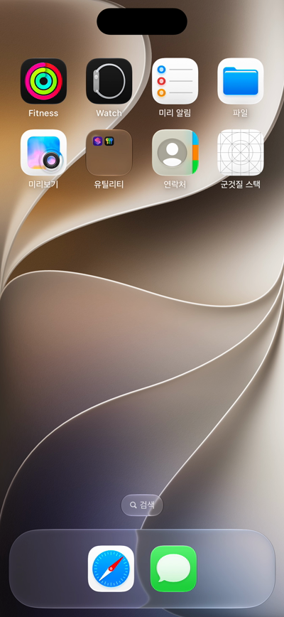
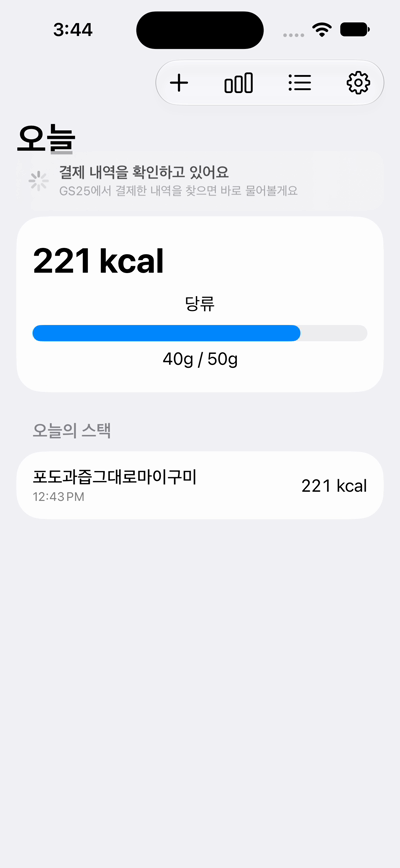
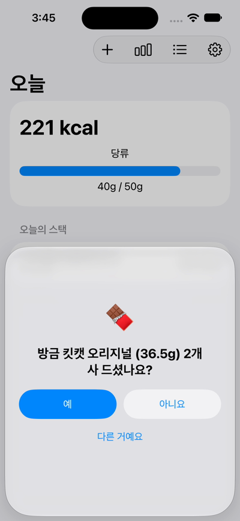

# 군것질 스택 (CALORIES_project)

> **당신이 결제하는 순간, 당신의 군것질을 알아차립니다.**

편의점에서 결제하면 "방금 킷캣 2개 사 드셨나요?"라고 묻고, 원탭으로 그날의 군것질 칼로리·당류를 쌓는 iPhone 앱 (MVP 개발 중).

| 홈 화면 | 결제 확인 중 | 결제를 찾음 |
|---|---|---|
|  |  |  |

시연 영상: [`docs/media/demo_iphone16.mp4`](docs/media/demo_iphone16.mp4) (iPhone 16 시뮬레이터, 시연용 결제 데이터)

## 어떻게 동작하나

```
편의점 진입 (지오펜스, Apple 지도 검색으로 주변 GS25·CU·세븐일레븐·이마트24)
  → 잠금화면 라이브 액티비티 "결제하셨으면 탭하세요"
  → 탭 (앱 열림) → 서버 tap-check가 카드 승인 내역 조회 (0·20·45·90초, 하루 10회 상한)
  → 새 승인: 가맹점 분류 → 내 군것질 목록에서 금액 조합 매칭 → 예측 저장
  → 앱이 Realtime으로 받아 "킷캣 오리지널 2개 사 드셨나요?" [예][아니요][다른 거예요]
  → 오늘의 스택에 칼로리·당류 기록, 응답은 학습 데이터(라벨)
```

- iOS는 다른 앱의 알림·화면을 읽을 수 없으므로, 결제 데이터는 **카드사 승인 내역을 서버에서 직접 조회**한다 (지금은 CODEF, 장기 목표는 마이데이터).
- 자세한 설계와 결정 이유: [`PLAN.md`](PLAN.md) · 세션별 진행 기록: [`HANDOFF.md`](HANDOFF.md)

## 폴더

| 경로 | 내용 |
|---|---|
| `ios/` | SwiftUI 앱 (`project.yml` → `xcodegen`으로 `Calories.xcodeproj` 생성) |
| `ios/Calories/App/` | 앱 진입점, 전역 상태(`AppModel`), 알림 액션, Supabase 연결 |
| `ios/Calories/Features/` | 온보딩·카드 연결, 홈(오늘 스택), 확인 시트, 내 군것질 목록·카탈로그 검색, 통계, 설정 |
| `ios/Calories/Location/` | 지오펜스 (주변 편의점 20곳 감시, 라이브 액티비티 시작·갱신) |
| `ios/CaloriesWidgets/` | 라이브 액티비티(잠금화면·다이내믹 아일랜드) 위젯 확장 |
| `ios/Shared/` | 앱과 위젯이 함께 쓰는 라이브 액티비티 속성, 딥링크 |
| `supabase/migrations/` | DB 스키마·RLS·함수 (0001 ~ 0012, 원격 프로젝트 `calories`에 적용됨) |
| `supabase/functions/` | Edge Functions: `card-connect`(카드 연결 + 30일 내역), `tap-check`(탭 후 조회) |
| `supabase/functions/_shared/` | CODEF 클라이언트(RSA 포함), Stage 1 매칭, 승인 저장·예측 |
| `supabase/functions/tests/` | 서버 통합 테스트 (실제 DB에 테스트 사용자를 만들어 검증 후 삭제) |
| `catalog/mfds_collect.py` | 식약처 식품영양성분DB 수집 → 스낵류 46,799개 `products` 적재 |
| `experiments/codef_latency/` | CODEF 지연 측정 도구 (탭 모드 / `--watch` 감시 모드) |
| `experiments/sim_demo.py` | 시뮬레이터 자동 시연 + 녹화 |

## 실행

비밀 키는 `CALORIES_project/.env`에만 둔다 (git 제외). 필요한 키: `MFDS_API_KEY`, `SUPABASE_URL`, `SUPABASE_SECRET_KEY`, `CODEF_ENV`, `CODEF_CLIENT_ID`, `CODEF_CLIENT_SECRET`, `CODEF_PUBLIC_KEY`.

```bash
# Python 도구 (macOS 기본 Python 3.9)
python3 -m venv .venv && .venv/bin/pip install -r experiments/codef_latency/requirements.txt

# iOS 앱 (Xcode 27, iPhone 16 시뮬레이터 = iOS 27.0 런타임)
cd ios && xcodegen
xcodebuild -project Calories.xcodeproj -scheme Calories -destination 'platform=iOS Simulator,name=Calories iPhone 16' \
  -derivedDataPath build CODE_SIGN_IDENTITY="-" CODE_SIGN_STYLE=Manual build   # 로컬 서명 필수 (없으면 로그인 유지 안 됨)

# 서버 테스트
deno test --allow-env --allow-read --allow-write --allow-run=openssl supabase/functions/_shared/   # 단위
deno test --allow-net --allow-env --allow-read supabase/functions/tests/                          # 통합 (실제 DB)

# Edge Functions 배포 (CLI에는 다른 프로젝트도 보이므로 --project-ref 필수)
supabase functions deploy tap-check card-connect --project-ref uzhtkykhkfcqsswfityg --use-api

# 카탈로그 재적재 (검수된 상품은 덮어쓰지 않음)
.venv/bin/python catalog/mfds_collect.py fetch && .venv/bin/python catalog/mfds_collect.py load
```

## 현황 (2026-10-29)

- ✅ 샌드박스 기준 전 구간 동작: 카드 연결 → 30일 내역 → 탭 조회 → 매칭 → 확인 → 스택, 승인 취소 시 되돌리기
- ✅ 시뮬레이터 시연 (iPhone 16)
- ⏳ **CODEF 데모로 실제 카드 결제 지연 측정** (측정용 카드: 우리카드)
- ⏳ 실기기 설치(지오펜스·라이브 액티비티), 푸시 알림(Apple 개발자 계정 필요), UI/UX 정리
- ⚠️ 카카오뱅크·토스뱅크 체크카드는 CODEF 미지원 → 장기적으로 마이데이터
